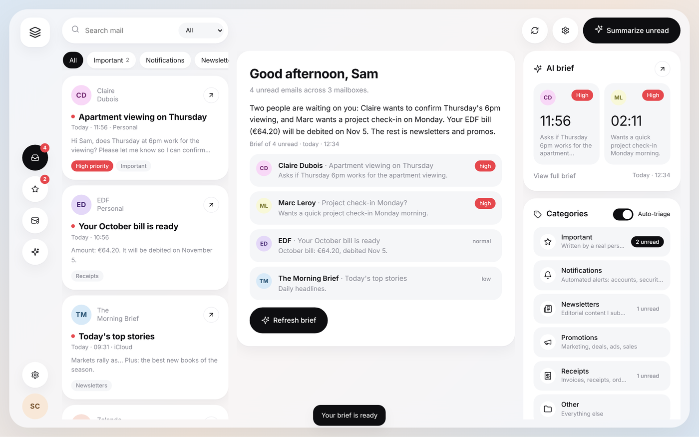

# Beseder

**All your mailboxes in one calm inbox, with your own AI assistant.**
Gmail, Outlook and iCloud together, on your phone and your computer, running on your own
Raspberry Pi.



- **Sorts your mail** into Important, Notifications, Newsletters, Promotions, Receipts and Other.
- **Briefs you**: one tap and the AI tells you what matters in your unread mail.
- **Drafts replies**, only when you ask. You read it and send it yourself.
- **Never acts alone**: the AI cannot send, delete, move or forward anything.
- **Free to run**: use a free AI (OpenRouter, Google), a local one (Ollama) or your Claude subscription.

## Quick start (5 minutes)

You need a computer that stays on (a Raspberry Pi is perfect) with
[Docker](https://docs.docker.com/engine/install/) installed.

```bash
git clone https://github.com/S2K7x/Beseder.git
cd Beseder
docker compose up -d
```

Open **http://localhost:8000** on that machine: a setup assistant walks you through
everything (your name, your mailboxes, your AI).

To use it from your iPhone, follow the [install guide](docs/install.md): it takes one
more command with Tailscale.

## Guides

| I want to… | Read |
|---|---|
| Install Beseder on a Raspberry Pi, step by step | [docs/install.md](docs/install.md) |
| Connect Gmail, iCloud, Outlook or another mailbox | [docs/mailboxes.md](docs/mailboxes.md) |
| Choose and connect an AI | [docs/ai.md](docs/ai.md) |
| Understand how Beseder keeps my mail safe | [docs/security.md](docs/security.md) |
| Fix a problem | [docs/troubleshooting.md](docs/troubleshooting.md) |
| Change the code | [docs/development.md](docs/development.md) |

## Everyday commands

Run them in the `Beseder` folder.

| What | Command |
|---|---|
| Start | `docker compose up -d` |
| Stop | `docker compose down` |
| Update to the latest version | `git pull && docker compose up -d --build` |
| See what's happening | `docker compose logs -f` |
| Back up your data | `docker compose cp beseder:/data ./beseder-backup` |

Your settings and mail live in a Docker volume: updating or restarting never loses them.
