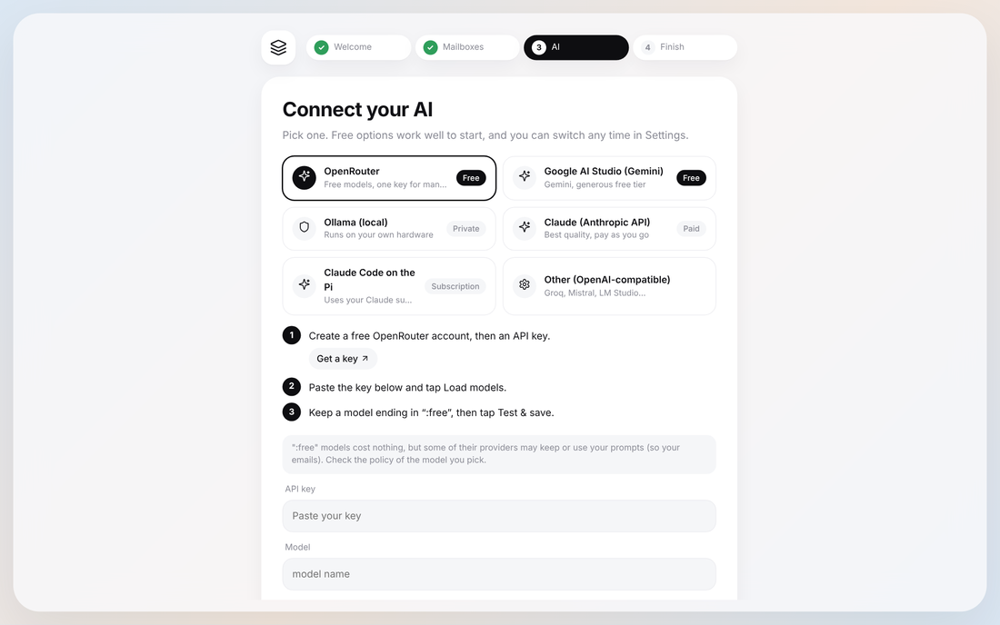

# Choose and connect an AI

Beseder works with the AI of your choice. You connect it in the setup assistant or in
**Settings › AI provider**: pick one, follow the numbered steps, tap **Test & save**.



## Which one should I pick?

| AI | Cost | Privacy | Good for |
|---|---|---|---|
| **OpenRouter** | Free (`:free` models) | Some free providers may keep your prompts | Starting out, trying several models |
| **Google AI Studio** | Free with daily limits | On the free tier, Google may use prompts to improve its products | A solid free option |
| **Ollama** | Free | Nothing leaves your home | Privacy. Needs a capable machine |
| **Claude (Anthropic API)** | Pay per use | API data is not used for training by default | Best quality |
| **Claude Code on the Pi** | Included in your Claude subscription | Follows your Claude account's privacy settings | If you already pay for Claude |

**Not sure?** Start with OpenRouter or Google: it's free and takes two minutes. You can
switch at any time; your mail and settings stay.

Remember that "the AI reads your email" means the text of your unread emails is sent to
that provider. Pick one you're comfortable with.

## OpenRouter

1. Create an account at [openrouter.ai](https://openrouter.ai) and open
   [Keys](https://openrouter.ai/settings/keys) to create a key.
2. Paste it in Beseder and tap **Load models**.
3. Keep **Free models only** ticked. Beseder picks one; tap **Test & save**.

## Google AI Studio

1. Open [aistudio.google.com/apikey](https://aistudio.google.com/apikey) and create a key.
2. Paste it in Beseder, tap **Load models** (Beseder picks a "Flash" model, fast and free),
   then **Test & save**.

## Ollama

Ollama runs AI models on your own hardware. A Raspberry Pi 5 can run a small model, but
slowly. A computer with a recent graphics card or an Apple Silicon Mac is much faster:
it can be any machine on your Tailscale network.

1. Install Ollama from [ollama.com/download](https://ollama.com/download) and download a model:
   ```bash
   ollama pull llama3.2
   ```
2. **If Beseder runs in Docker on the same machine**, Ollama must accept connections from
   the Docker container. Start it with `OLLAMA_HOST=0.0.0.0`. On Linux:
   ```bash
   sudo systemctl edit ollama
   # add these two lines, then save:
   # [Service]
   # Environment="OLLAMA_HOST=0.0.0.0"
   sudo systemctl restart ollama
   ```
   Beseder already points to `http://host.docker.internal:11434/v1`.
3. **If Ollama runs on another machine**, change the API URL to that machine's address,
   for example `http://my-pc.tail1234.ts.net:11434/v1`.
4. Tap **Load models**, pick one, then **Test & save**.

## Claude (Anthropic API)

1. Create a key at [console.anthropic.com/settings/keys](https://console.anthropic.com/settings/keys)
   and add a few dollars of credit.
2. Paste it in Beseder. The models are already chosen: Claude Haiku for sorting (cheap and
   fast) and Claude Opus for briefs and drafts.
3. Tap **Test & save**.

## Claude Code

This uses your Claude subscription (Pro or Max) through the Claude Code command-line tool.
Beseder runs it with **no tools and no MCP servers**, so it can only read the text Beseder
gives it.

**With Docker** (the usual setup):

1. Rebuild Beseder with Claude Code inside:
   ```bash
   WITH_CLAUDE_CLI=true docker compose up -d --build
   ```
   To make it permanent, put `WITH_CLAUDE_CLI=true` in a `.env` file next to
   `docker-compose.yml`.
2. Sign in once. The sign-in is stored in Beseder's data volume and survives restarts:
   ```bash
   docker compose exec -it beseder claude
   ```
   Follow the sign-in steps, then type `/exit`.
3. In Beseder, choose **Claude Code on the Pi** and tap **Test & save**.

**Without Docker:** sign in by running `claude` once in a terminal on the Pi, then choose
**Claude Code on the Pi** in Beseder. If Beseder can't find it, open **Advanced** and enter
the full path given by `which claude`.

## Other providers

Any service with an OpenAI-compatible API works (Groq, Mistral, LM Studio, vLLM…). Choose
**Other**, enter the API URL (it usually ends in `/v1`) and the key, then load the models.

## Settings worth knowing

- **Brief language** (Settings › Profile): the language of your briefs. Drafts always
  follow the language of the email you answer.
- **Auto-triage** (the switch in Categories): when on, each new email is sorted by the AI.
  If you correct a category with the tag button, that sender always goes there, before the
  AI is even asked.
