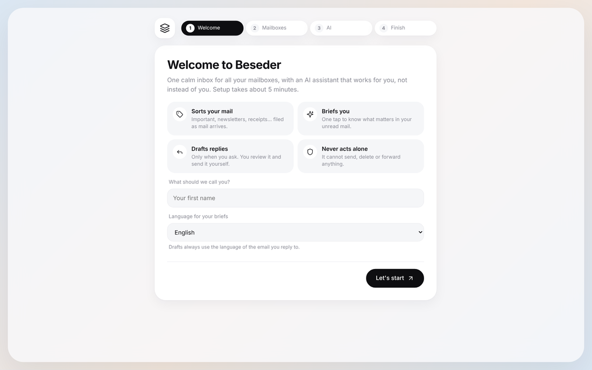

# Install Beseder on a Raspberry Pi

This guide takes about 15 minutes. You type a few commands on the Pi, then everything
else happens in the app.

**What you need**

- A Raspberry Pi 4 or 5 (or any Linux computer that stays on), with Raspberry Pi OS 64-bit.
- A terminal on the Pi (keyboard and screen, or SSH).
- An iPhone or computer to use the app.

## 1. Install Docker

Docker runs Beseder in a box with everything it needs, so you don't install Python or
anything else yourself.

```bash
curl -fsSL https://get.docker.com | sh
sudo usermod -aG docker $USER
```

Log out and back in (or reboot) so the second command takes effect. Check it works:

```bash
docker run --rm hello-world
```

## 2. Download and start Beseder

```bash
git clone https://github.com/S2K7x/Beseder.git
cd Beseder
docker compose up -d
```

The first start takes a few minutes (it builds the app). Check that it's running:

```bash
docker compose ps
```

You should see `beseder` with the status `healthy`.

## 3. Reach it from your phone with Tailscale

For safety, Beseder only answers on the Pi itself. [Tailscale](https://tailscale.com) gives
your devices a private network: your phone can reach the Pi from anywhere, and nobody
else can. It's free for personal use.

**On the Pi:**

```bash
curl -fsSL https://tailscale.com/install.sh | sh
sudo tailscale up
```

Open the link it prints and sign in.

**In the Tailscale admin console** ([login.tailscale.com/admin/dns](https://login.tailscale.com/admin/dns)):
turn on **MagicDNS** and **HTTPS Certificates**.

**Back on the Pi**, publish Beseder on your private network:

```bash
sudo tailscale serve --bg 8000
tailscale serve status
```

The last command shows your address, for example
`https://raspberrypi.tail1234.ts.net`.

> Never use `tailscale funnel`: it would put Beseder on the public internet.

**On your iPhone:** install the Tailscale app, sign in with the same account, and turn it on.

## 4. Open Beseder and follow the setup

1. On your iPhone, open your Beseder address in **Safari**.
2. Tap **Share › Add to Home Screen**. Beseder now opens like an app.
3. The setup assistant asks for your name, your mailboxes and your AI. Each step shows
   what to do, with links. Details: [mailboxes](mailboxes.md) and [AI](ai.md).



You can run the assistant again any time from **Settings › Help › Run setup again**.

## 5. Turn on notifications

In Beseder, open **Settings › Notifications** and tap **Turn on for this device**, then
**Send a test**. By default you are notified about **important** emails only (this needs
auto-triage on); you can switch to every new email, or off.

On iPhone, notifications need iOS 16.4 or later and only work when Beseder is opened from
its **Home Screen** icon (step 4), not from a Safari tab. Do it once on each device you
want notified.

## Keeping it up to date

```bash
cd Beseder
git pull
docker compose up -d --build
```

## Back up and restore

Your settings, encrypted passwords and synced mail are in a Docker volume.

```bash
# Back up
docker compose cp beseder:/data ./beseder-backup

# Restore (on a new Pi, after step 2)
docker compose cp ./beseder-backup/. beseder:/data
docker compose restart
```

Keep backups somewhere private: they contain the key that decrypts your mailbox passwords.

## Optional settings

Create a file named `.env` next to `docker-compose.yml` to change these:

| Setting | Default | What it does |
|---|---|---|
| `BESEDER_PORT` | `8000` | Port on the Pi. If you change it, use the same one in `tailscale serve`. |
| `BESEDER_ALLOWED_HOSTS` | `localhost,127.0.0.1,*.ts.net` | Addresses Beseder answers to. Add yours if you don't use Tailscale. |
| `WITH_CLAUDE_CLI` | `false` | `true` bundles Claude Code to use your Claude subscription. See [AI](ai.md#claude-code). |

Then run `docker compose up -d --build`.

## Without Docker

If you prefer, Beseder also runs directly with Python 3.10+: see [development](development.md).
