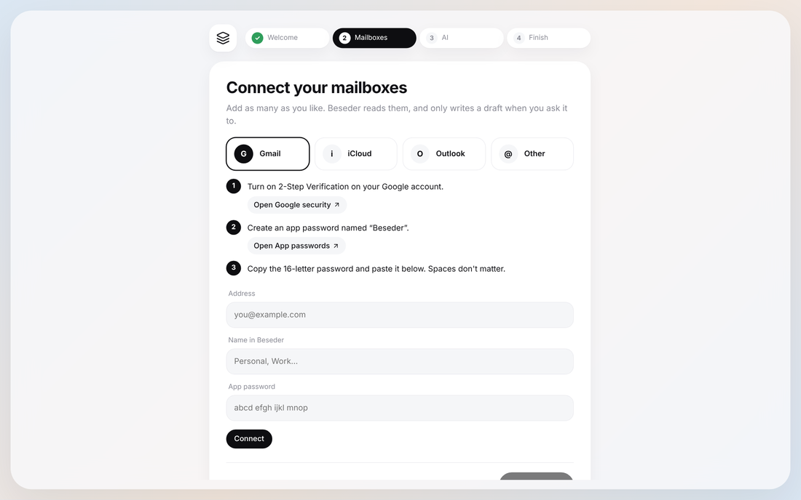

# Connect your mailboxes

Beseder reads your mail over IMAP, the standard every mail provider supports. For most
providers you give it an **app password**: a separate password that only works for mail
and that you can revoke at any time without changing your main password.

You add mailboxes in the setup assistant or in **Settings › Mailboxes**. Just type your
address: Beseder recognizes the provider (for example `@yahoo.fr` → Yahoo,
`@wanadoo.fr` → Orange) and shows the right steps.

| Provider | What you need | Jump to |
|---|---|---|
| Gmail | App password (2-Step Verification on) | [Gmail](#gmail) |
| Outlook, Hotmail, Live | Microsoft sign-in, one-time setup | [Outlook](#outlook) |
| iCloud (icloud.com, me.com, mac.com) | App-specific password | [iCloud](#icloud) |
| Yahoo, AOL | App password | [Yahoo and AOL](#yahoo-and-aol) |
| Fastmail, Zoho, GMX, Yandex | App password (or IMAP switch) | [Other international](#other-international-providers) |
| Orange, Free, SFR, La Poste, Bbox | Usual or mail password | [French providers](#french-providers) |
| Anything else | IMAP server + password | [Other](#any-other-provider) |

## Gmail

1. Turn on **2-Step Verification**: [myaccount.google.com/signinoptions/twosv](https://myaccount.google.com/signinoptions/twosv).
   App passwords don't exist without it.
2. Open **App passwords**: [myaccount.google.com/apppasswords](https://myaccount.google.com/apppasswords).
3. Type `Beseder` and tap **Create**.
4. Paste the 16-letter password in Beseder (spaces don't matter).

Good to know:
- Changing your Google password **revokes all app passwords**: create a new one afterwards.
- No App passwords page? It's hidden for accounts using only security keys, Advanced
  Protection, or a work/school account whose admin turned app passwords off.
- IMAP is always on in Gmail: there is nothing to enable.

## Outlook

Outlook.com, Hotmail, Live and MSN addresses **no longer accept passwords or app passwords**
from mail apps (Microsoft switched them off in September 2024). The only way in is the
official Microsoft sign-in (OAuth). For that, Microsoft wants each app to have its own ID,
created once in Microsoft's developer portal. It's free, but takes about 10 minutes.

### 1. Get a free Microsoft directory

Microsoft no longer lets a personal account create app IDs on its own: you first need a
"directory". The simplest way is a free Azure account:

1. Go to [azure.microsoft.com/free](https://azure.microsoft.com/free) and sign up with your
   Microsoft account. Microsoft may ask for a card to verify your identity; creating an app
   ID costs nothing.
2. Once done, open [portal.azure.com](https://portal.azure.com).

### 2. Create the app ID

1. In the search bar, open **App registrations**, then **New registration**.
2. **Name**: `Beseder`.
3. **Supported account types**: choose **Accounts in any organizational directory and
   personal Microsoft accounts**. ("Personal Microsoft accounts only" also works.)
4. Leave **Redirect URI** empty and click **Register**.
5. In the left menu, open **Authentication**, set **Allow public client flows** to **Yes**,
   then **Save**.
6. Open **API permissions › Add a permission › APIs my organization uses**, search
   `Office 365 Exchange Online`, choose **Delegated permissions**, tick
   `IMAP.AccessAsUser.All`, then **Add permissions**.
7. Go back to **Overview** and copy the **Application (client) ID**.

### 3. Connect in Beseder

1. Choose **Outlook**, enter your address and paste the client ID.
2. Tap **Sign in with Microsoft**. Beseder shows a short code.
3. Open [microsoft.com/devicelogin](https://microsoft.com/devicelogin) on any device, type
   the code, sign in and accept. Beseder finishes on its own.

The same app ID works for all your Outlook mailboxes: Beseder remembers it.

**Don't want to go through Azure?** In Outlook.com, open **Settings › Mail › Forwarding**
and forward your mail to a mailbox Beseder can read (Gmail, for example). You'll see it in
Beseder, but drafts will be saved in that other mailbox.

## iCloud

1. Make sure two-factor authentication is on for your Apple Account.
2. Sign in at [account.apple.com](https://account.apple.com), open **Sign-In and Security ›
   App-Specific Passwords** and tap **+**. Name it `Beseder`.
3. Paste the password (it looks like `abcd-efgh-ijkl-mnop`) in Beseder with your
   `@icloud.com`, `@me.com` or `@mac.com` address.

Apple's username is usually the part before `@`, sometimes the full address: Beseder tries
both for you.

## Yahoo and AOL

Yahoo and AOL belong to the same company and work the same way.

1. Open your account security page:
   [Yahoo](https://login.yahoo.com/account/security) or
   [AOL](https://login.aol.com/account/security).
2. Tap **Generate app password** (sometimes under "Other ways to sign in"), name it
   `Beseder`.
3. Paste it in Beseder with your full address.

Your normal Yahoo or AOL password will be rejected: it has to be the app password.

## Other international providers

**Fastmail**: Settings › Privacy & Security › **Manage app passwords and access**, create a
password with access to Mail (IMAP).

**Zoho Mail**: make sure IMAP access is on in Zoho Mail's settings, then create an
**app-specific password** in your Zoho account's Security section. If your account is hosted
in Europe (zoho.eu), Beseder uses `imap.zoho.eu`; for other data centers, change the server
in **Advanced server settings** (for example `imap.zoho.in`).

**GMX**: in GMX webmail, open **Settings › POP3 & IMAP** and allow IMAP access, then use
your normal password (or an app password if you turned on two-factor authentication).
`gmx.com` addresses use `imap.gmx.com`, other GMX addresses `imap.gmx.net`: Beseder picks
the right one.

**Yandex**: in Yandex Mail settings › **Email clients**, turn on IMAP and "App passwords
and OAuth tokens", then create an app password of type **Mail** in Yandex ID (it is shown
only once).

## French providers

| Provider | Addresses | Before connecting |
|---|---|---|
| **Orange** | orange.fr, wanadoo.fr | Turn on **POP/IMAP access** in Orange Mail (Settings › Security, off by default), then create the **mail app password** in your Espace client › Connexion et sécurité. Use that password, not your usual one. |
| **Free** | free.fr | Nothing to turn on: your usual password. |
| **La Poste** | laposte.net | Nothing to turn on: your usual password. |
| **SFR** | sfr.fr, neuf.fr, club-internet.fr | Your mailbox password. |
| **Bouygues** | bbox.fr | Your mailbox password. |

## Any other provider

Choose **Other (IMAP)** and fill in the server and port from your provider's help pages
(often `imap.yourprovider.com`). Port **993** connects with SSL, port **143** with
STARTTLS: both are encrypted, Beseder never connects in clear text. This covers web hosts
and custom domains such as OVH, Infomaniak, IONOS or your own server.

Every provider also has **Advanced server settings** under the password field if you need
to change the server, port or username.

### Proton Mail

Proton Mail encrypts mail so that no regular IMAP client can read it directly. It needs
**Proton Mail Bridge**, a paid-plan feature that has no official build for the Raspberry Pi.
Beseder doesn't support Proton for now.

## What Beseder does with your mailbox

- It watches your **inbox** and shows new mail within seconds (IMAP IDLE), with a full
  check every 5 minutes as a safety net. The first sync imports the last 30 days.
- It marks an email as read when you open it, like any mail app.
- It saves a draft in your **Drafts** folder when you tap the save arrow.
- It moves an email out of the inbox when **you** tap Archive or Move (with an Undo).
  Gmail's archive is "All Mail"; other providers use their Archive folder, created if
  missing. The trash is never offered.
- That's all: no sending, no deleting. Removing a mailbox from Beseder deletes nothing in
  the mailbox itself. Attachments are downloaded from your mailbox when you open them.

To revoke access at any time, delete the app password at your provider, or for Microsoft
remove Beseder at [account.live.com/consent/Manage](https://account.live.com/consent/Manage).
